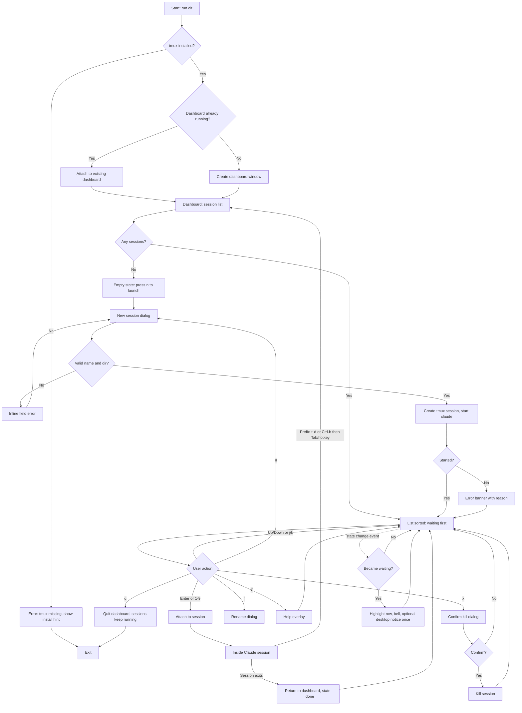

# UX Design: WO-C2E5A3 "AI tmux"

## Assumptions
- The dashboard is a full-screen terminal UI (TUI) run in its own tmux window/session, named `dash`. Managed sessions are separate tmux sessions with a prefix (`ait-`).
- Minimum terminal size 60x15; designed for 80x24 and up.
- Keybindings are defaults; the architect may change them, but copy and behaviour below assume these.
- Launch is available both as a CLI command (`ait new`) and as a dialog inside the dashboard.
- Notifications: terminal bell always; desktop notification if available (optional setting).

## 1. Personas and top tasks

**Primary persona: Jag, solo power user.** Runs 3-8 Claude Code sessions across projects, is keyboard-first, lives in the terminal, and hates being blocked unnoticed. Tolerates no mouse-only flows.

| # | Top task | Success measure |
|---|---|---|
| 1 | See which sessions need me | Glance at the dashboard, under 2s |
| 2 | Jump into a waiting session | 1 keystroke (Enter or number) |
| 3 | Return to the dashboard | 1 keystroke (documented key) |
| 4 | Launch a new session | Under 10s, name and directory only |
| 5 | Know a session finished or died | State shown, no crash |

## 2. User flows



## 3. Screens

### 3.1 Dashboard (main screen)

**Layout (80x24):**
```
 AI tmux                          3 waiting · 2 running · 1 idle
 ─────────────────────────────────────────────────────────────
  #  STATE      NAME          PROJECT                 SINCE
 ▶1  ● WAITING  api-refactor  ~/code/api              2m
  2  ● WAITING  docs-site     ~/code/docs             40s
  3  ◐ RUNNING  migrate-db    ~/code/billing          5m
  4  ◐ RUNNING  fix-tests     ~/code/web              12s
  5  ○ IDLE     scratch       ~/tmp/scratch           1h
  6  ✓ DONE     old-spike     ~/code/spike            3h
 ─────────────────────────────────────────────────────────────
 Enter open · n new · x kill · r rename · ? help · q quit
```

**Components**
- **Header:** product name, summary counts (waiting count in the accent colour).
- **Session table:** columns `#` (1-9, then blank), State, Name, Project (path shortened with `~`, truncated in the middle), Since (time in current state).
- **Selection marker:** `▶` plus reverse video on the selected row.
- **Footer:** key hints; a transient status message appears on the line above it.

**Ordering:** waiting first (oldest wait first), then running, idle, done. The order is stable between refreshes except on state change. The selection follows the session, not the row index.

**State encoding (never colour alone):**

| State | Icon + label | Colour |
|---|---|---|
| Waiting for input | `● WAITING` bold | yellow/amber, row bold |
| Running | `◐ RUNNING` | green |
| Idle | `○ IDLE` | dim |
| Done/exited | `✓ DONE` | dim grey |
| Unknown | `? UNKNOWN` | dim, only when detection fails |

If the terminal has no Unicode support, fall back to ASCII: `!`, `*`, `-`, `x`, `?`.

**Screen states**
- **Empty:** centred message: "No sessions yet." / "Press **n** to launch your first Claude Code session, or run `ait new <name> <dir>`." Footer shows only `n new · ? help · q quit`.
- **Loading (first paint, under 1s):** "Looking for sessions…" in the table area. If it lasts more than 3s, add "Still looking. Is tmux responding?"
- **Error (tmux server unreachable):** banner on red: "Can't reach tmux. Sessions may still be running. Retrying…" with retry every 2s. The list shows the last known data, marked "stale" in the header.
- **Degraded detection:** header suffix "State detection: fallback mode (hooks not found)". The affected rows show `?` if the state is uncertain.
- **Populated with many sessions:** the table scrolls; the header counts are always visible; a `↓ 4 more` indicator appears at the bottom.

### 3.2 New session dialog (modal, centred, 56 cols)

```
┌ New Claude Code session ─────────────────────────┐
│ Name       [api-refactor____________]            │
│ Directory  [~/code/api______________]            │
│                                                  │
│ Enter launch · Tab next field · Esc cancel       │
└──────────────────────────────────────────────────┘
```
- Name: default is the directory basename; allowed `a-z 0-9 - _`; max 24.
- Directory: default is the current working directory of the dashboard; Tab completes the path.
- **Loading:** button text "Launching…", fields disabled.
- **Errors (inline, under the field):** see microcopy.

### 3.3 Confirm kill dialog
```
┌ Kill session? ───────────────────────────────────┐
│ "migrate-db" is running. Unsaved work in this    │
│ session will be lost.                            │
│                                                  │
│ y kill · n or Esc keep                           │
└──────────────────────────────────────────────────┘
```
Default is "keep" (Enter does nothing; `y` must be typed).

### 3.4 Rename dialog
Single field, prefilled with the current name; the same validation as New.

### 3.5 Help overlay
Lists all keys (section 6), the return key for sessions, and the state legend. Closes with any key.

### 3.6 Inside a session
The session is plain tmux. A one-line tmux status bar (the manager configures it for `ait-` sessions) shows: `‹name› · Ctrl-b Tab → dashboard · 2 waiting`. The waiting count is clickable-free (text only) and updates as states change, so the user can see other blocked sessions without leaving.

## 4. Notifications
- On a transition into waiting: one bell, one optional desktop notification titled "Claude is waiting: ‹name›" with body "‹project›". Fires once per transition; no repeat until the session leaves waiting and re-enters.
- If the user is already attached to that session, no notification fires.
- The dashboard row flashes (reverse video) for 2s, then stays bold.
- Burst control: if several sessions go waiting within 2s, send one combined notification: "3 sessions are waiting".

## 5. Microcopy

| Context | Copy |
|---|---|
| Empty state | "No sessions yet. Press n to launch one." |
| Launch success (status line) | "Started ‹name›." |
| Name empty | "Give the session a name." |
| Name invalid | "Use letters, numbers, - and _ only." |
| Name taken | "A session called ‹name› already exists. Pick another name." |
| Dir missing | "That folder doesn't exist. Check the path." |
| Dir not a directory | "That path is a file, not a folder." |
| Claude not found | "Couldn't start Claude Code: `claude` isn't on your PATH." |
| tmux missing | "AI tmux needs tmux. Install it with `brew install tmux` or your package manager." |
| tmux unreachable | "Can't reach tmux. Sessions may still be running. Retrying…" |
| Session ended | "‹name› finished." (row becomes DONE) |
| Session vanished | "‹name› is no longer running." |
| Kill confirm | "Kill ‹name›? Unsaved work in it will be lost." |
| Kill success | "Killed ‹name›." |
| Quit hint | "Sessions keep running after you quit." |
| Fallback detection | "State detection: fallback mode. Status may be less precise." |
| Terminal too small | "Terminal too small. Need at least 60×15." |
| Desktop notification | Title "Claude is waiting: ‹name›", body "‹project›" |

Tone: short, plain, no blame, and every error says what to do next.

## 6. Keyboard behaviour

| Key | Action |
|---|---|
| `↑` `↓` / `k` `j` | Move selection |
| `g` / `G` | First / last |
| `Enter` | Open selected session |
| `1`-`9` | Open the session with that number directly |
| `w` | Jump selection to the next waiting session |
| `n` | New session |
| `r` | Rename |
| `x` | Kill (with confirm) |
| `?` | Help |
| `q` / `Ctrl-c` | Quit dashboard (sessions keep running) |
| `Esc` | Close dialog or overlay |
| From inside a session: `Ctrl-b Tab` | Return to dashboard (configurable) |
| From inside a session: `Ctrl-b d` | Standard tmux detach also works |

Rules:
- Every action is reachable by keyboard; no mouse is required (mouse is optional, ignored by default).
- Focus in dialogs is trapped; Tab/Shift-Tab cycle fields; Enter submits; Esc cancels.
- Number keys act only in the main list, never in text fields.
- Keys typed while a modal is open never reach the list.
- Focus returns to the previously selected session after any dialog closes.

## 7. Responsive behaviour (terminal size)

| Width | Behaviour |
|---|---|
| ≥100 cols | Full table; Project shows the full path where it fits |
| 80-99 | As in the wireframe; Project truncated in the middle |
| 60-79 | Drop the SINCE column; Project truncated more |
| <60 or <15 rows | Show "Terminal too small" message only; still handles `q` |

- Height: header (2 lines) and footer (2 lines) are fixed; the table takes the rest and scrolls.
- Resize events re-layout immediately, preserving selection.
- Dialogs shrink to terminal width minus 4; field labels stack above fields below 60 cols.
- Colour: works in 16 colours; honours `NO_COLOR`, relying on icons and labels.

## 8. Implementation notes for the Developer
- Refresh: event-driven where hooks exist; otherwise poll at ≤1s so state changes show within 2s.
- "Since" updates once per second without re-sorting.
- The selection key is the session ID, not the row index.
- Debounce state flicker: a state must hold for 500ms before it is shown, and notifications only fire on a confirmed transition.
- Never block the UI on tmux calls; show last known data and the stale marker on timeout.
- Accessibility: all state is conveyed by text label as well as colour and icon.
